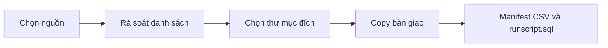

# Delivery Copy

Công cụ portable trên Windows để gom file bàn giao từ file/thư mục hoặc so sánh hai nhánh Git. Không cần cài đặt, EXE, .NET SDK hay build source.

## Có gì trong app?

- Chọn file, thư mục hoặc dán danh sách path.
- So sánh hai branch Git để lấy file thay đổi mới nhất.
- Review danh sách gọn, include/exclude, tìm kiếm, lọc và sort package path.
- Copy giữ nguyên cấu trúc thư mục, xử lý file trùng, đối soát SHA-256.
- Xuất manifest CSV và tùy chọn tạo `runscript.sql` cho SQL*Plus.

## Luồng sử dụng

## Chạy app

1. Giải nén ZIP.
2. Double-click `DeliveryCopy.cmd`.
3. Chọn nguồn ở **1 Select files**.
4. Kiểm tra package path ở **2 Review**.
5. Chọn đích và bấm **Start delivery** ở **3 Deliver**.

Windows 10/11 đã có sẵn PowerShell 5.1 và WPF. Chỉ cần cài Git for Windows nếu dùng Git comparison.

## So sánh Git mới nhất

1. Chọn thư mục nằm trong repository.
2. Bấm **Load branches**, chọn **Base branch** và **Compare branch**.
3. Bấm **Add Git changes**.

Mỗi lần Add Git changes, app chạy `git fetch --all --prune` rồi diff remote-tracking refs mới nhất của hai branch. Vì vậy kết quả **không phụ thuộc local branch đã pull hay chưa**.

App không chạy `git pull`, merge, rebase, checkout, reset, commit hoặc push; không làm đổi branch hiện tại hay source file.

## Review và bàn giao

- Tick để include file; bỏ tick để exclude.
- Dùng tìm kiếm, filter và nút mũi tên để sort package path trước khi tạo runscript.
- Hover package path để xem đầy đủ đường dẫn.
- Khi chọn đích, app báo folder có tồn tại không và số file trùng.
- Folder chưa tồn tại chỉ được tạo sau khi user xác nhận.
- Chọn **Skip**, **Overwrite** hoặc **Rename automatically** để xử lý file trùng.

## File đầu ra

| File | Ý nghĩa |
| --- | --- |
| Cây thư mục bàn giao | File đã copy theo package path |
| `delivery_manifest_*.csv` | Kết quả copied, skipped, failed, cancelled |
| `runscript.sql` | Tùy chọn, chạy các SQL file đã copy theo thứ tự Review |

`runscript.sql` không chứa password. SQL*Plus sẽ hỏi password khi chạy.

## Lỗi thường gặp

| Hiện tượng | Cách xử lý |
| --- | --- |
| Không load được branch | Chọn đúng thư mục repository và kiểm tra `git --version`. |
| Không có file sau diff | Kiểm tra branch, remote access và path file có còn trên compare branch. |
| App không lên | Chạy từ thư mục đã giải nén và xem `DeliveryCopy_startup_error.log`. |
| Giao diện chưa đổi sau update | Đóng app rồi chạy lại `DeliveryCopy.cmd` trong thư mục bản mới. |

## Open source

| File | Vai trò |
| --- | --- |
| `App.ps1` | Logic giao diện và luồng app |
| `UI.xaml` | Layout, màu sắc, style |
| `Core.Git.ps1` | Git fetch và diff |
| `Core.FileOps.ps1` | Gom/copy/hash/manifest |
| `Core.SqlPlus.ps1` | Tạo runscript |

PR/issue được chào đón. Không commit credentials, manifest, `runscript.sql` hoặc log. Repository hiện chưa có license file; cần thêm license trước khi phân phối bản chỉnh sửa hoặc nhận đóng góp bên ngoài.
